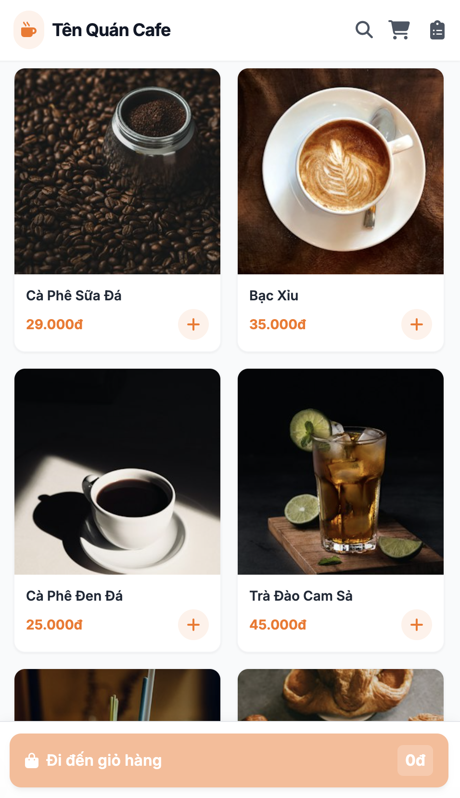
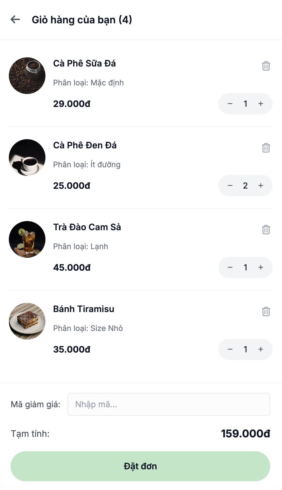
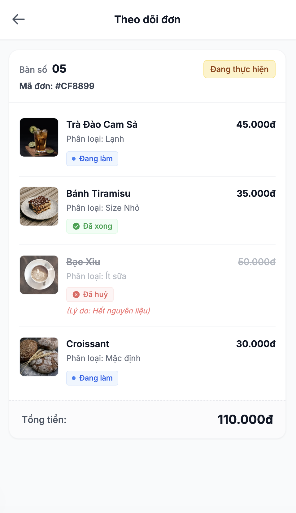

# PA#1 – Hệ thống đặt món tại quán cà phê

> Đã điền bài toán, người dùng và phạm vi từ tài liệu nguồn. Điền thông tin nhóm, hoàn thiện luồng và màn hình, rồi xóa hướng dẫn trước khi nộp.

## 1. Team

<!-- Phụ trách: TV1 -->

| Thành viên | Họ và tên | MSSV |
| --- | --- | --- |
| TV1 | [Họ tên] | [MSSV] |
| TV2 | [Họ tên] | [MSSV] |
| TV3 | Nguyễn Huỳnh Huy Phát | 24120406 |

## 2. The problem

Trong bối cảnh giả định của một quán cà phê có một địa điểm kinh doanh, nhân viên hiện ghi nhận yêu cầu gọi món trên giấy hoặc trực tiếp tại quầy, chuyển thông tin cho nhân viên pha chế và tính tiền khi khách yêu cầu; quản lý tổng hợp doanh thu từ các phiếu bán hàng vào cuối ngày. Vào giờ cao điểm, cách làm này có thể gây thất lạc phiếu, ghi nhận thiếu món và chậm cập nhật khi khách thay đổi yêu cầu. Thông tin rời rạc cũng khiến khách khó theo dõi tiến độ món, nhân viên mất thời gian kiểm tra đơn và quản lý mất công đối chiếu doanh thu. Quán vì vậy cần một website hỗ trợ khách tự đặt món tại bàn qua mã QR, đồng thời tập trung thông tin đặt món, pha chế, giao nước và thanh toán để các bên phối hợp và theo dõi chính xác hơn.

## 3. Users

| Loại người dùng | Công việc muốn hoàn thành |
| --- | --- |
| Khách hàng tại bàn | Quét QR để xem thực đơn, giá và tình trạng phục vụ; chọn món, số lượng, ghi chú và gửi yêu cầu; gọi thêm trong cùng lượt phục vụ, theo dõi tiến độ và điều chỉnh hoặc hủy món khi còn được phép, để quán nhận đúng yêu cầu và khách biết món đang được xử lý đến đâu. |
| Nhân viên pha chế | Xem yêu cầu theo bàn, món, số lượng và ghi chú; cập nhật lúc bắt đầu, pha xong hoặc báo món không thể phục vụ kèm lý do, để tránh bỏ sót món và thông báo kịp thời cho phục vụ và khách. |
| Nhân viên phục vụ | Kiểm tra có khách thực tại bàn và duyệt yêu cầu đầu để mở lượt phục vụ; theo dõi món đã pha xong, giao đúng bàn và xác nhận đã giao; kiểm tra đơn, thu toàn bộ hoặc tách hóa đơn theo món/số lượng, ghi nhận khoản đã thu và kết thúc lượt khi thanh toán hết, để không giao trùng, thu trùng hoặc lẫn đơn giữa các lượt khách. |
| Quản lý | Cập nhật thực đơn, giá và tình trạng còn/hết; quản lý bàn, mã QR, tài khoản và quyền nhân viên; tra cứu đơn và xem doanh thu theo thời gian, để duy trì thông tin bán hàng chính xác và theo dõi hoạt động của quán. |

## 4. Main flow

<!-- TV2 viết bước 1–2; TV3 viết bước 3. Ba màn hình liên tiếp thuộc cùng một luồng khách đặt món. Nêu thao tác và kết quả, không chỉ liệt kê tên màn hình. -->

**Người thực hiện:** Khách hàng tại bàn.

**Điểm bắt đầu:** [Khách quét QR của bàn và truy cập thực đơn.]

1. **S1 – Thực đơn:** [Khách chọn món, số lượng và thao tác để chuyển sang S2.]
2. **S2 – Kiểm tra và gửi đơn:** [Khách kiểm tra, điều chỉnh giỏ hàng, nhập ghi chú và gửi đơn để chuyển sang S3.]
3. **S3 – Theo dõi đơn:**

- Sau khi khách hàng gửi đơn thành công, hệ thống ghi nhận thông tin đơn hàng và danh sách món đã đặt vào cơ sở dữ liệu.

- Hệ thống chuyển giao diện sang màn hình **Theo dõi đơn**, hiển thị mã đơn, số bàn, trạng thái đơn (*Đang thực hiện*), danh sách món đã đặt, trạng thái từng món và tổng tiền đơn hàng.

- **Trường hợp món được hoàn thành:**
  - Nhân viên pha chế hoàn tất việc chuẩn bị món.
  - Nhân viên phục vụ cập nhật trạng thái món thành *Đã xong* trên hệ thống.
  - Hệ thống lưu trạng thái mới vào cơ sở dữ liệu và cập nhật thông tin trên giao diện theo dõi đơn của khách hàng.

- **Trường hợp món bị hủy:**
  - Nhân viên pha chế thông báo không thể thực hiện món, kèm theo lý do hủy.
  - Nhân viên phục vụ cập nhật trạng thái món thành *Đã hủy* và nhập lý do hủy trên hệ thống.
  - Hệ thống lưu trạng thái và lý do hủy vào cơ sở dữ liệu, đồng thời tính toán lại tổng tiền đơn hàng bằng cách loại trừ giá tiền của món bị hủy.
  - Giao diện theo dõi đơn của khách hàng cập nhật trạng thái *Đã hủy*, hiển thị lý do hủy và tổng tiền mới.

- **Trường hợp hoàn tất đơn hàng:**
  - Khi tất cả món trong đơn đã được xác định kết quả xử lý (*Đã xong* hoặc *Đã hủy*), nhân viên phục vụ mang các món đã hoàn thành đến khách hàng.
  - Sau khi hoàn tất việc phục vụ, nhân viên phục vụ cập nhật trạng thái đơn hàng thành *Đã hoàn thành* trên hệ thống.
  - Hệ thống lưu trạng thái mới vào cơ sở dữ liệu và cập nhật giao diện theo dõi đơn của khách hàng.
  - Luồng theo dõi đơn kết thúc khi đơn hàng được xác nhận hoàn thành.

## 5. Scope

### Building

Website phục vụ khách tại bàn của **một quán cà phê, một địa điểm kinh doanh**, truy cập bằng trình duyệt trên điện thoại, máy tính bảng hoặc máy tính có kết nối Internet.

- **Đặt món qua QR:** xác định đúng bàn; xem thực đơn; chọn món, số lượng, ghi chú; kiểm tra trước khi gửi. Nhân viên phục vụ duyệt yêu cầu đầu tiên để mở lượt và chuyển đơn chính thức sang pha chế; khách có quyền tham gia lượt đang mở được gọi thêm vào cùng đơn.
- **Theo dõi và điều chỉnh món:** khách xem tiến độ; sửa hoặc hủy theo trạng thái và quy định của quán. Nhân viên pha chế cập nhật tiến độ, báo món không thể phục vụ và lý do; khách xác nhận hủy hoặc đặt món thay thế.
- **Giao nước:** nhân viên phục vụ xem món đã pha xong, giao đúng bàn và xác nhận đã giao.
- **Thanh toán và kết thúc lượt:** nhân viên kiểm tra đơn, xác nhận đã nhận tiền, thu toàn bộ bàn hoặc tách hóa đơn theo món/số lượng; lưu lịch sử giao dịch, khoản đã thu và phần còn phải trả; kết thúc lượt khi đã thanh toán hết. Giữ nguyên đơn giá đã ghi nhận, loại món hủy hợp lệ khỏi số tiền phải trả và không áp dụng giảm giá hoặc phụ phí.
- **Quản trị và phân quyền:** quản lý món, nhóm món, giá bán, tình trạng phục vụ, bàn, QR và tài khoản nhân viên. Nhân viên và quản lý đăng nhập, chỉ thao tác theo quyền được cấp.
- **Tra cứu và doanh thu:** quản lý tra cứu đơn và xem doanh thu theo khoảng thời gian; doanh thu chỉ tính các hóa đơn đã xác nhận thu tiền, kể cả phần đã thu của bàn còn mở.

### Not building

- Đặt món từ xa, mua mang đi hoặc giao hàng.
- Quản lý nhiều chi nhánh.
- Quản lý kho nguyên liệu.
- Quản lý nhân sự ngoài tài khoản và phân quyền sử dụng hệ thống.
- Chương trình khách hàng thân thiết.
- Tích hợp cổng thanh toán hoặc tự động xác thực giao dịch ngân hàng.
- Phát hành hóa đơn điện tử hoặc hoàn tiền sau thanh toán.
- Hoạt động khi mất kết nối Internet.

Nhân viên trực tiếp pha chế, giao nước và xác nhận đã nhận tiền; website hỗ trợ ghi nhận và theo dõi. Đơn được phân biệt theo từng lượt phục vụ tại bàn để không lẫn dữ liệu giữa các lượt khách.

## 6. Screens

<!-- Mỗi màn hình có một đoạn ngắn: người dùng muốn làm gì, thao tác chính và đi đâu tiếp theo. Hình và nội dung phải khớp; mọi nút/link phải có đích đến hoặc được giải thích trong văn bản. -->

### S1 – Thực đơn

<!-- Phụ trách: TV2 -->

[Viết một đoạn giải thích mục đích của khách tại màn hình này, thao tác chọn món và cách chuyển sang S2. Giải thích các nút/link còn lại nếu có.]

### S2 – Kiểm tra và gửi đơn

<!-- Phụ trách: TV2 -->

[Viết một đoạn giải thích cách khách kiểm tra và điều chỉnh đơn, gửi đơn để sang S3 hoặc quay lại S1. Giải thích các nút/link còn lại nếu có.]

### S3 – Theo dõi đơn

<!-- Phụ trách: TV3 -->

Màn hình **Theo dõi đơn** cho phép khách hàng theo dõi tình trạng xử lý của đơn hàng sau khi đặt món thành công:
1. **Thông tin đơn**
   - Số bàn: Hiển thị số bàn mà khách hàng đang sử dụng.
   - Mã đơn: Mã định danh duy nhất của đơn hàng, hỗ trợ tra cứu và đối chiếu khi cần thiết.
   - Trạng thái đơn hàng: Cho biết tiến độ xử lý tổng thể của đơn, bao gồm Đang thực hiện và Hoàn thành.
2. **Danh sách món đã đặt**  
Mỗi món được hiển thị kèm hình ảnh, tên món, phân loại hoặc tùy chọn đã chọn, giá tiền và trạng thái xử lý riêng giúp khách hàng theo dõi tiến độ mà không cần kiểm tra trực tiếp với nhân viên:
   - Đang làm (xanh dương): Món đang được nhân viên pha chế chuẩn bị.
   - Đã xong (xanh lá): Món đã được chuẩn bị xong và sẵn sàng phục vụ.
   - Đã hủy (đỏ): Món đã bị hủy; hệ thống hiển thị thêm lý do hủy để khách hàng nắm được thông tin.
3. **Tổng tiền đơn**  
Hiển thị tổng giá trị các món thuộc đơn, không bao gồm những món đã bị hủy. Tổng tiền được cập nhật tương ứng khi có thay đổi về danh sách món hoặc trạng thái hủy.
4. **Điều hướng**   
Nút `←` ở góc trên bên trái cho phép khách hàng quay lại màn hình menu để tiếp tục xem món và thực hiện một đơn mới.   
Khách hàng hoàn toàn có thể quay lại theo dõi đơn hiện tại từ màn hình menu.
